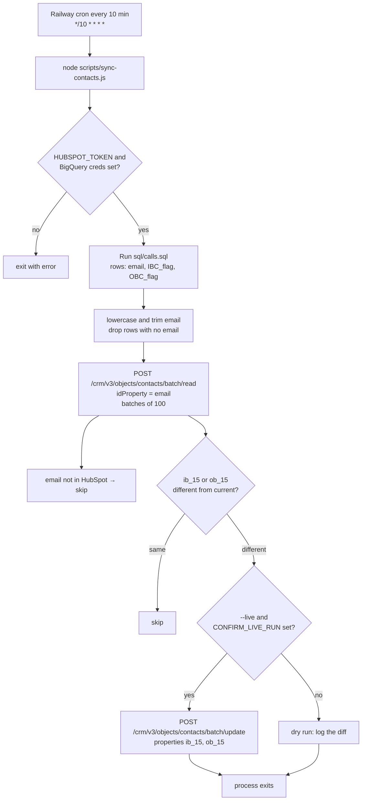

# BigQuery → HubSpot contact sync

A 10-minute Railway cron. Each run queries BigQuery, matches existing HubSpot contacts by email, and writes two custom contact properties: `ib_15` and `ob_15`.

Contacts that are not already in HubSpot are left alone. The job does not create contacts.

## Flow



## Files

| File | Job |
|---|---|
| `package.json` | Node 18+. Dependencies: `@google-cloud/bigquery`, `axios`. Script: `"start": "node scripts/sync-contacts.js"`. |
| `railway.toml` | Nixpacks build. `startCommand = "node scripts/sync-contacts.js --live"`. The process must exit when the run finishes. |
| `.env.example` | Empty placeholders only: `HUBSPOT_TOKEN`, `BQ_PROJECT_ID`, `GOOGLE_APPLICATION_CREDENTIALS_JSON`, `CONFIRM_LIVE_RUN`. |
| `sql/calls.sql` | One query. `IBC_flag` and `OBC_flag` are written to the contact properties named by `HUBSPOT_IB_PROPERTY` and `HUBSPOT_OB_PROPERTY` as dropdown values `true` and `false`. |
| `lib/bigquery.js` | Build a BigQuery client from the service-account JSON in the env var. Run `sql/calls.sql`. Return rows. |
| `lib/hubspot.js` | `Authorization: Bearer ${HUBSPOT_TOKEN}` against `https://api.hubapi.com`. Batch-read contacts by email. Batch-update `ib_15` and `ob_15`. One retry after 1.5s on HTTP 429. |
| `scripts/sync-contacts.js` | Cron entry. Check env. Refuse to write unless both `--live` and `CONFIRM_LIVE_RUN=yes` are set. Normalize email, diff, then patch. |

No Express app and no webhook route. Shape: GitHub repo, Railway service, start command, cron schedule in the Railway dashboard.

## HubSpot setup before the first deploy

Create two contact number properties whose internal names are exactly `ib_15` and `ob_15`. These are contact properties, not company properties.

Private App token goes in `HUBSPOT_TOKEN`, with contact read and contact write.

Find contacts with:

`POST /crm/v3/objects/contacts/batch/read`

```json
{
  "idProperty": "email",
  "properties": ["email", "ib_15", "ob_15"],
  "inputs": [{ "id": "a@x.com" }]
}
```

Write changed contacts with:

`POST /crm/v3/objects/contacts/batch/update`

```json
{
  "inputs": [
    {
      "id": "12345",
      "properties": { "ib_15": "…", "ob_15": "…" }
    }
  ]
}
```

Send a property only when the SQL value is non-empty and different from the current value, so a blank cell does not wipe HubSpot. Cap each request at 100 contacts.

## Railway

1. Push the repo to GitHub and create a Railway service from it.
2. Variables, set in Railway: `HUBSPOT_TOKEN`, `BQ_PROJECT_ID`, `GOOGLE_APPLICATION_CREDENTIALS_JSON` (the service-account JSON as one variable), `HUBSPOT_IB_PROPERTY`, and `HUBSPOT_OB_PROPERTY`. The contact property names are read only from those two variables. Leave `CONFIRM_LIVE_RUN` unset until a dry run looks right.
3. Cron schedule: `*/10 * * * *`. [Railway schedules cron in UTC](https://docs.railway.com/cron-jobs). IST is UTC+5:30, and this expression still runs every 10 minutes in IST, at minute 30, 40, 50, 00, 10, and 20.
4. First runs only log diffs. Add `CONFIRM_LIVE_RUN=yes` when you want writes.

The BigQuery service account needs `bigquery.jobs.create` and read access to the tables in `sql/calls.sql`.

## Prompt for the other project

```text
Build a Node 18 cron job, GitHub repo deployed on Railway. No web server.

Every 10 minutes (Railway cron */10 * * * *), run sql/calls.sql in BigQuery.
The query returns email, IBC_flag, and OBC_flag. Those booleans are written as the dropdown values true and false.
Match existing HubSpot contacts by email (lowercase, trimmed).
Update only the contact properties named by HUBSPOT_IB_PROPERTY and HUBSPOT_OB_PROPERTY.
Skip emails that are not already contacts. Do not create contacts.
Skip a property when the SQL value is empty. Skip the contact when both values
already match HubSpot.

HubSpot: Private App token in HUBSPOT_TOKEN.
POST https://api.hubapi.com/crm/v3/objects/contacts/batch/read with idProperty "email".
POST https://api.hubapi.com/crm/v3/objects/contacts/batch/update.
Batches of 100. Retry once after 1.5s on 429.

BigQuery: @google-cloud/bigquery, project BQ_PROJECT_ID, service-account JSON
in GOOGLE_APPLICATION_CREDENTIALS_JSON. Never commit credentials.

Files: package.json, railway.toml, .env.example, sql/calls.sql,
lib/bigquery.js, lib/hubspot.js, scripts/sync-contacts.js.
Start command: node scripts/sync-contacts.js --live.
Writes only if CONFIRM_LIVE_RUN=yes is also set. Otherwise log the diff and exit.
Process must exit when the run finishes.
```
